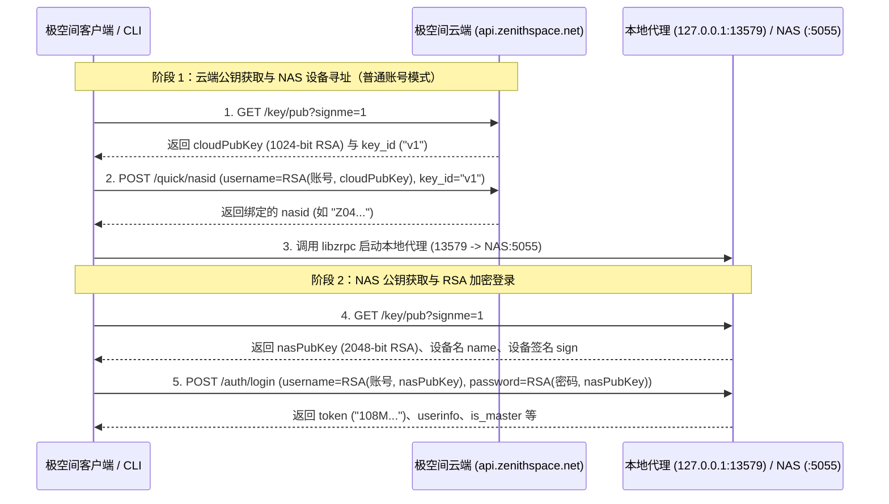

# 极空间 (ZSpace) macOS 客户端逆向分析：本地配置、代理架构与鉴权协议

本文档基于对极空间 macOS 桌面客户端（Electron `v2.45.2026082601`）本地配置目录、`app.asar` 主进程/渲染进程代码、`libzrpc.dylib` 动态库调用逻辑以及开源项目 [`skyzhao1223/zspace-cli`](https://github.com/skyzhao1223/zspace-cli) 的逆向与实测整理而成。

> **安全说明**：本文档中所有涉及用户真实凭证（如 `token`、`sign`、账号、序列号、WebDAV 密码等）均已脱敏并替换为占位符，实际开发时请通过配置文件动态读取。

---

## 一、 本地配置文件结构 (`~/Library/Application Support/zspace/`)

极空间 macOS 客户端基于 Electron 构建，其 `userData` 目录固定位于：
```text
~/Library/Application Support/zspace/
```
（跨平台参考：Windows 位于 `%APPDATA%\zspace` 或 `%LOCALAPPDATA%\zspace`，Linux 候选路径为 `~/.zspace` 或 `~/.config/zspace`。）

### 1.1 `zspace.conf` —— 硬件指纹与播放器端口配置

位于 `~/Library/Application Support/zspace/zspace.conf`，是一个单行 JSON 文件：

```json
{
  "key": "<MAC_ADDRESS_OR_UUID>",
  "deviceId": "<32_HEX_MD5_OF_KEY>",
  "hostname": "Mac-mini.local",
  "platform": "mac",
  "playerPort": 13601
}
```

#### 核心字段与生成算法（逆向自 `background.js`）：
- **`key`**：客户端首次启动时枚举 `os.networkInterfaces()`（按网卡名排序），跳过虚拟网卡前缀（`virtual`, `vmware`, `hyper-v`, `parallels`, `vbox`, `docker`, `tun`, `tap`, `loopback`），取第一个非 `00:00:00:00:00:00` 的物理网卡 MAC 地址；若获取失败则生成随机 UUID v4。
- **`deviceId`**：直接对 `key` 计算 **MD5**（32 位小写十六进制字符串）：
  $$\text{deviceId} = \text{MD5}(\text{key})$$
- **`platform`**：`os.platform() === "darwin"` 时为 `"mac"`，否则为 `"pc"`。
- **`playerPort`**：Electron 主进程启动本地 TCP Server（用于与内置播放器 `UZPlayer.app` 通信）所监听的随机端口，计算方式为 `13600 + Math.floor(20 * Math.random())`（通常落在 `13600~13619`）。

---

### 1.2 `vuex.json` —— 核心状态与登录凭证存储

位于 `~/Library/Application Support/zspace/vuex.json`，由客户端通过 `electron-store` / Vuex 持久化插件明文保存（未启用 `encryptionKey`）。文件发生变化（如重新登录、刷新 Token、切换设备）时会自动重写。

```json
{
  "state": {
    "app": {
      "develpmentMode": false,
      "develpmentBase": "http://127.0.0.1:8001",
      "device": "Mac（Mac mini）",
      "ua": "Mozilla/5.0 (Macintosh; Intel Mac OS X 10_15_7) AppleWebKit/537.36 (KHTML, like Gecko) zspace/2.45.2026082601 Netscape Electron/31.4.0 ",
      "version": "1.0",
      "plat": "mac",
      "uploadSlice": 0,
      "uploadProcess": 4,
      "downloadByIp": false,
      "connectFileServiceMode": 0,
      "deviceId": "<DEVICE_ID_32_HEX>",
      "downloaderUA": "PotPlayer/1.7.21953",
      "localSyncPort": 0,
      "localPort": 13579
    },
    "nas": {
      "nasId": "<NAS_ID_13_CHARS>",
      "nasIp": [],
      "clientPublicIp": "<PUBLIC_IP>",
      "webBase": "https://www.zconnect.cn",
      "nasName": "<NAS_NAME>",
      "cloudPubKey": "-----BEGIN PUBLIC KEY-----\n...\n-----END PUBLIC KEY-----",
      "cloudPubKeyId": "v1",
      "nasPubKey": "-----BEGIN PUBLIC KEY-----\n...\n-----END PUBLIC KEY-----",
      "locale": "zh_cn",
      "sign": "<NAS_SIGN_TOKEN>",
      "color": "al_ti_gray",
      "devicePdt": "z4",
      "deviceMode": "z4pro+",
      "diskNum": 4,
      "series": "z"
    },
    "user": {
      "token": "<USER_AUTH_TOKEN>",
      "username": "<PHONE_OR_USERNAME>",
      "qcname": "",
      "keyName": "<PHONE_OR_USERNAME>",
      "avatar": "/auth/avatar/...",
      "isMaster": 1,
      "loginInfo": {
        "loginMode": "normal",
        "lockTime": 0,
        "remember": true,
        "keepLogin": true,
        "loginPort": 5055,
        "deviceIp": "",
        "nasId": "<NAS_ID_13_CHARS>",
        "lockNow": false
      },
      "settings": {
        "<PHONE_OR_USERNAME>": {
          "showHiddenFile": 0,
          "diskCode": "极空间-个人",
          "mountCachePath": "/Users/<user>/缓存",
          "mountS3": true,
          "hashCheck": 0,
          "hashCheckOption": "simple"
        }
      },
      "historyUsers": [
        {
          "username": "<PHONE_OR_USERNAME>",
          "isMaster": 1,
          "mode": "normal",
          "ip": "",
          "token": "<USER_AUTH_TOKEN>",
          "nasId": "<NAS_ID_13_CHARS>",
          "deviceMode": "z4pro+",
          "nickname": "<NICKNAME>",
          "tls": false,
          "nasName": "<NAS_NAME>",
          "is_local": 0,
          "t": 1781942609828
        }
      ],
      "mountHomeDir": "<PHONE_OR_USERNAME>",
      "mountVolume": "极空间-个人"
    }
  }
}
```

#### CLI 必读关键字段路径：
| 字段路径 | 含义 | 用途 |
| :--- | :--- | :--- |
| `state.user.token` | 用户会话 Token（`108M...` 开头） | 核心鉴权凭证，放入请求 Form Body、Header 或 Cookie |
| `state.nas.nasId` | 13 位设备序列号（如 `Z04...`） | 标识目标 NAS，对应参数 `nasid` 或 Cookie `nas_id` |
| `state.app.deviceId` | 32 位设备 MD5 指纹 | 标识当前客户端设备，对应参数 `device_id` |
| `state.app.device` | 设备显示名（如 `Mac（Mac mini）`） | 分片上传 `/v2/file/upload` 等接口必传 Header/Cookie（需 URL 编码） |
| `state.app.version` | 客户端协议版本（固定 `"1.0"`） | 分片上传及 PC 原生接口使用的 `version` |
| `state.app.localPort` | 本地代理监听端口（默认 `13579`） | 本地 HTTP 代理入口端口 |
| `state.nas.sign` | 设备签名（`061W...` 开头） | 换绑/短信/邮箱验证及客户端 Cookie 注入字段 |
| `state.nas.cloudPubKey` | 极空间云端 1024-bit RSA 公钥 | 登录前加密账号以向云端查询 `nasId` 或发送短信 |
| `state.nas.nasPubKey` | NAS 设备端 2048-bit RSA 公钥 | 登录时加密账号与密码发送给 `/auth/login` |

---

### 1.3 `proxy/` 目录与日志体系

1. **`proxy/api-conf.json`**：
   - 由原生代理库 `libzrpc.dylib` 维护的加密路由/节点配置缓存（Base64 编码的二进制密文）。
2. **`proxy/log.txt` & `proxy/log-backup.txt`**：
   - `libzrpc.dylib` 输出的底层网络隧道日志（容量上限 100MB，超限轮转到 `log-backup.txt`）。
   - 记录了每次 HTTP 代理请求解析（`/zrpc_delegate.cpp`）、TCP 端口转发（`/tcp_specific.cpp`）、直连/P2P/Relay 建连过程（例如直连 `192.168.x.x:5055` 或通过 `*.direct.zspace.link:5056` 进行 TLS 握手）。
3. **`clientConsole.txt` & `clientConsole.old.txt`**：
   - Electron 主进程与渲染进程的运行日志（由 `electron-log` 输出），包含 Axios 请求异常、本地代理启动结果、播放器与挂载状态等。
4. **`<username>/mount/mount.conf`**：
   - 极空间「本地挂载盘」功能配置文件。客户端通过 `ZSpaceMountMonitor` 调用定制版 rclone（`ZSpaceMount`）配合 `go-nfsv4`（`fuse-t`），将本地代理暴露的 WebDAV 端口（如 `http://127.0.0.1:13602`）挂载为 macOS 本地卷。

---

## 二、 本地代理服务架构 (`libzrpc.dylib`)

极空间桌面客户端自身不直接用 JS 处理复杂内网穿透，而是通过 `@lwahonen/ffi-napi` 加载位于：
```text
/Applications/极空间.app/Contents/Resources/app.asar.unpacked/sdk/libzrpc.dylib
```
的 C++ 动态库（Windows 下为 `libzrpc_x64.dll`）。

### 2.1 `libzrpc` FFI 导出函数与 `encodeService` 加密机制

在 `background.js` 中，客户端声明了如下 FFI 接口：
```javascript
new ffi.Library(libzrpcPath, {
  libzrpc_init: ["int", ["string"]],
  libzrpc_uninit: ["void", []],
  libzrpc_refresh: ["bool", []],
  libzrpc_check_ports: ["string", ["string"]],
  libzrpc_start_service: ["string", ["string"]],
  libzrpc_stop_service: ["void", ["string"]],
  libzrpc_stop_all_service: ["void", []],
  libzrpc_network_diagnose: ["string", ["string"]],
  libzrpc_link_diagnose: ["string", ["string"]],
  libzrpc_get_nas_status: ["string", []],
  libzrpc_search_device: ["string", []],
  libzrpc_set_device_type: ["void", ["string"]],
  libzrpc_set_private_network_access: ["int", ["string", "int", "bool", "bool"]],
  libzrpc_detect_nas: ["string", ["string", "bool"]],
  libzrpc_set_ipv6_priority: ["void", ["int"]],
  libzrpc_check_conn_ability: ["string", ["string", "int"]],
  libzrpc_get_force_tunnel: ["bool", []],
  libzrpc_set_force_tunnel: ["void", ["bool"]]
})
```

**`encodeService` 参数加密算法**：
调用 `libzrpc_start_service` 启动端口映射时，传入的 JSON 配置（如 `{local_port: 13579, remote_port: 5055, type: 1, nas_id: "...", ts: 17924...}`）并非明文，而是使用 **AES-256-GCM**（无 AuthTag 附加，仅取 `update + final` 密文转 Base64）加密：
1. 使用固定种子 `4728423` 初始化标准 **MT19937 (Mersenne Twister)** 伪随机数生成器；
2. 连续生成 64 个 `uint32` 整数并按十进制字符串拼接为 `t`；
3. 计算 `h = SHA256(t).hex()`；
4. 取 `key = h.substring(0, 32)`（32 字节 ASCII），`iv = h.substring(0, 16)`（16 字节 ASCII）；
5. 执行 `AES-256-GCM` 加密并 Base64 编码后传给 `libzrpc_start_service`。

### 2.2 本地监听端口全景表

实测极空间客户端主进程（PID）与挂载子进程在 `127.0.0.1` 上监听的端口如下：

| 本地端口 | 远端目标端口 | `request_purpose` | 用途说明 |
| :--- | :--- | :--- | :--- |
| **`127.0.0.1:13579`** | NAS `:5055` (或 `:8050`) | 默认 / `4`(上传) / `5`(下载) | **核心 HTTP 代理端口**（`state.app.localPort`）。承载所有 Web API、文件上传下载、网页端静态资源 (`/home/`) |
| **`127.0.0.1:13581`** | NAS `:22000` | `7` | **Syncthing 同步服务 TCP 代理端口**。API Key 计算公式为 `MD5(nasId + "zconnect").substr(0, 16)` |
| **`127.0.0.1:13600`** / **`13602`** | NAS `:9001` | `8` | **本地挂载 (rclone WebDAV/S3) 代理端口**。从 `13600` 起分配，供 `ZSpaceMount` 挂载使用 |
| **`127.0.0.1:13601`** | 本地 IPC | — | **内置播放器控制端口**（`zspace.conf` 中的 `playerPort`，`13600~13619` 随机） |
| **`127.0.0.1:12345`** | 本地诊断 | — | `libzrpc` 内置网络诊断页（`http://127.0.0.1:12345/netinfo`，快捷键 `Ctrl+Shift+O`） |
| **`127.0.0.1:10000+`** | Docker 容器端口 | 动态 | 远程访问 / 云手机 / Docker 应用（如青龙面板）动态分配的本地代理端口 |

### 2.3 本地代理 (`127.0.0.1:13579`) vs 局域网 IP 直连 (`<NAS_IP>:5055` / `:8050`)

通过逆向与实测对比，极空间支持两种请求路径：

1. **通过桌面客户端本地代理 (`http://127.0.0.1:13579`) 【推荐默认方式】**
   - **优势**：自动复用 `libzrpc` 已建立的隧道（局域网内自动走直连 `<NAS_IP>:5055`，外网环境自动切换 P2P / 中继隧道），无需关心当前网络拓扑，且天然满足部分仅限本地代理访问的接口策略。
   - **注意事项**：在 macOS 上发请求访问 `127.0.0.1:13579` 时，**必须绕过系统 HTTP 代理**（如 Python `httpx.Client(trust_env=False)` 或 `curl --noproxy 127.0.0.1`），否则若用户开启了 Clash/Surge 等系统代理，请求会被错误劫持并返回 `502 Bad Gateway`。
2. **局域网 IP 直连 (`http://<NAS_IP>:5055` 与 `http://<NAS_IP>:8050`)**
   - **发现设备**：可通过 `libzrpc_search_device()` 或云端接口 `GET https://proxy.zenithspace.net/tracker/query?platform=nas&zrp=v2&id=<NAS_ID>` 获取局域网 IP（字段 `local_addrs`）。
   - **端口分工**：
     - **`5055`（HTTP 非加密） / `5050`（TLS 加密）**：承载常规控制面与文件管理 API（实测直接向 `http://<NAS_IP>:5055` 发送带 Cookie 和 Form 参数的 `POST /zspool/info`、`POST /v2/file/list`、`POST /system/diskusage3`、`GET /key/pub?signme=1` 均返回 `200 OK`）。
     - **`8050`（文件数据面端口）**：客户端在局域网 IP 直连模式下（或启用 `downloadByIp` / `connectFileServiceMode == 1` 时），会将文件上传 (`/v2/file/upload`) 与下载 (`/v2/file/download`) 的目标地址从 `:5055` 替换为 `http://<NAS_IP>:8050`。若走本地代理 `127.0.0.1:13579`，则在 URL Query 和 Header 中附带 `remote_port=8050`（及 `remote-port: 8050`），由本地代理转发至 NAS 的 `8050` 端口。

---

## 三、 完整鉴权与加密/签名机制

### 3.1 完整登录握手流程（当需要独立登录或刷新 Token 时）

若不直接读取 `vuex.json` 中现成的 `token`，客户端完整的登录流程（逆向自 `chunk-6e4bd61c` 的 `validateSuccess` 与 `c24f` 模块）如下：



#### RSA 加密实现细节：
- 客户端使用 `JSEncrypt`（标准 **RSAES-PKCS1-v1_5** 填充，输出 Base64 字符串）。
- 当使用 `cloudPubKey`（云端公钥）或 `nasPubKey`（NAS 公钥）加密时，直接调用 `jsEncrypt.encrypt(plainText)` 即可：
  - `username` 需先去除首尾空白字符后再加密；
  - `password` 同样去除首尾空白字符后使用 `nasPubKey` 加密；
  - 若触发新设备二次验证（错误码 `N001414` 或 `N001204`），需调用云端 `/sms/usend` 与 `/sms/ucheck`（或 `/v2/email/check`）获取 `sms_proof` / `email_proof`，一并传入 `/auth/login`。

---

### 3.2 已登录态的 API 请求鉴权机制

对于 CLI 工具，推荐直接读取 `vuex.json` 中的 `state.user.token`、`state.nas.nasId` 和 `state.app.deviceId`。极空间 API 根据端点类型采用**双通道鉴权（Cookie + Form Body / Headers）**。

#### 1. 公共请求约定（适用于绝大多数管理与文件 API）
- **HTTP 方法**：绝大多数为 `POST`（少数如 `/home/static/version`、`/zstatus`、`/v2/file/download`、`/v2/file/tmpinfo` 为 `GET`）。
- **`Content-Type`**：`application/x-www-form-urlencoded`
- **URL Query 随机数后缀**：
  - Web 端风格（`zspace-cli` 采用）：`{endpoint}?&rnd={unix_ts}{random4}_{random4}&webagent=v2`
  - 桌面端原生风格（`app.d3d20628.js` 采用）：`{endpoint}?&drnd={ms_ts}_{random4}`
  - 两者在本地代理 `127.0.0.1:13579` 上均被接受。
- **公共 Form Body 参数**：
  | 参数名 | 示例值 / 来源 | 说明 |
  | :--- | :--- | :--- |
  | `token` | `state.user.token` | 必填，用户鉴权 Token |
  | `nasid` | `state.nas.nasId` | 必填，13 位 NAS ID（注意此处无下划线） |
  | `device_id` | `state.app.deviceId` | 必填，32 位设备 MD5 指纹 |
  | `plat` | `"web"` 或 `"pc"` | 平台标识（Web API 常用 `"web"`，客户端内部常用 `"pc"`） |
  | `version` | `"2.3.2026042401"` 或 `"1.0"` | `plat="web"` 时传网页端版本号，`plat="pc"` 时传 `state.app.version` (`"1.0"`) |
  | `_l` | `"zh_cn"` | 语言区域 (`state.nas.locale`) |
  | `paths[]` | `/sata11/my/data/...` | 批量操作（如 `move`/`copy`/`remove`/`statistic`）时的数组参数名（URL 编码为 `paths%5B%5D`） |

#### 2. Cookie 鉴权头构造
Electron 客户端通过 `session.defaultSession.cookies` 及请求拦截器注入如下 Cookie。为兼容所有 `POST` 接口及 `GET /v2/file/download` 下载接口，HTTP 客户端应当在 Cookie 中携带：
```http
Cookie: token=<TOKEN>; zenithtoken=<TOKEN>; nas_id=<NAS_ID>; nasid=<NAS_ID>; device_id=<DEVICE_ID>
```
> **注意字段名差异**：在 Form Body 和请求 Header 中 NAS 标识叫 `nasid`，而在 Cookie 中服务端往往读取 `nas_id`（`zenithtoken` 同理，与 `token` 值相同）。同时设置 `token`/`zenithtoken` 和 `nas_id`/`nasid` 是最稳妥的做法。

---

### 3.3 文件上传、下载与哈希校验的特殊协议

文件传输接口不走 `application/x-www-form-urlencoded`，而是使用 `application/octet-stream` 并将元数据放在 **HTTP Headers** 与 **Cookie** 中。

#### 1. 小文件单次上传：`POST /v2/file/create`
- **适用范围**：小文件（本地代理 openresty 对单次请求体有上限，超过约 64MB 可能返回 `HTTP 413 Payload Too Large`）。
- **请求头**：
  - `Content-Type: application/octet-stream`
  - `path`: 目标完整路径（如 `/sata11/my/data/test.txt`）。注意：含中文路径时，部分 HTTP 库（如 Python `httpx`）要求 Header 值为原始 UTF-8 字节串（`target.encode("utf-8")`）。
  - `Cookie`: 同上公共 Cookie。
- **请求体**：文件原始二进制流。

#### 2. 大文件分片上传与断点续传：`POST /v2/file/upload` & `GET /v2/file/tmpinfo`
- **会话 `uuid` 计算公式**（逆向自 `background.js` 的 `setUUID`）：
  ```python
  # 注意：mtime_ms (整数毫秒时间戳) 与 file_size (字节数) 先做算术加法，再转字符串与目标路径拼接！
  # 若路径以 /zenith_sata/my/data 开头需先替换为 /my（普通 /sata11/my/data 保持原样）
  uuid = hashlib.md5(f"{mtime_ms + file_size}{target_path}".encode("utf-8")).hexdigest()
  ```
- **查询断点偏移**：
  - `GET /v2/file/tmpinfo?path={target_path}&uuid={uuid}`
  - 若存在未完成会话，返回 `{"code": "200", "data": {"size": "6291456", ...}}`，取 `int(data.size)` 作为起始 `seek`；若无会话或已完成，返回 `N001315`（文件不存在），从 `seek=0` 开始上传。
- **分片上传请求 (`POST /v2/file/upload`)**：
  - **URL**：`/v2/file/upload?remote_port=8050&drnd={ms_ts}&uuid={uuid}`
  - **Body**：当前分片的裸字节流（远端/代理模式建议 `2 MiB` 一片，且**必须按 `seek` 严格单调递增顺序发送**，不可乱序并发，否则报 `N001530` 或导致文件静默损坏）。
  - **Headers 与 Cookie 镜像规则**：以下参数不仅要作为 HTTP Request Header 发送，还要**全部拼接进 `Cookie` Header**（在 Cookie 中将键名 `nasid` 改为 `nas_id`，所有值做 URL percent-encode）：
    | 字段名 | 取值说明 |
    | :--- | :--- |
    | `app` | `"file"` |
    | `path` | `urllib.parse.quote(target_path, safe="")` |
    | `size` | 文件总字节数 |
    | `uuid` | 上述计算的 32 位 MD5 会话 ID |
    | `seek` | 当前分片起始字节偏移量 |
    | `split` | `1` |
    | `Content-Length` | 当前分片字节长度 |
    | `modify_time` | `math.ceil(mtime_ms / 1000)`（秒级时间戳） |
    | `crtime` | 创建时间（秒级时间戳，可传 `""`） |
    | `rename` | `0`（覆盖/默认）或 `1`（自动重命名） |
    | `token` | `urllib.parse.quote(token, safe="")` |
    | `plat` | `"pc"` |
    | `nasid` | `state.nas.nasId`（放入 Cookie 时键名改为 `nas_id`） |
    | `version` | `state.app.version`（如 `"1.0"`） |
    | `device_id` | `state.app.deviceId` |
    | `device` | `urllib.parse.quote(state.app.device, safe="")` |
    | `request-purpose` | `4` |
    | `remote-port` | `8050` |

#### 3. 客户端文件哈希算法（逆向自 `background.js`）
客户端在上传与秒传/同名校验中定义了两种哈希算法：
1. **快速首尾特征哈希 (`getFSHash` + `POST /v2/file/hash`)**：
   - 用于检查远端同名文件是否内容一致：
     - 先将文件大小字符串 `str(file.size)` 写入 MD5 上下文；
     - 若 `file.size == 0`：直接输出 MD5；
     - 若 `0 < file.size <= 2048`：读取全部文件字节写入 MD5；
     - 若 `file.size > 2048`：读取**前 1024 字节**（`[0, 1023]`）与**最后 1024 字节**（`[size-1024, size-1]`）依次写入 MD5。
   - 配合调用 `POST /v2/file/hash`（参数 `paths[]: [target_path]`），对比返回的 `data.items[0].hash`。
2. **上传完整性校验哈希 (`calculateFileHash`)**：
   - 当启用上传哈希校验（`hashCheck: 1`）时，在上传 Header 中附带 `fileHash` 与 `fileHashCheckOption`：
     - **`complete` 模式（或文件 $\le 10\text{ MiB}$）**：计算全文件标准 MD5。
     - **`simple` 抽样模式**：
       - $10\text{ MiB} < \text{size} \le 500\text{ MiB}$：取首、中（`floor(size/2) - 51200` 起）、尾各 `100 KiB`（`102400` 字节）依次更新同一 MD5；
       - $500\text{ MiB} < \text{size} \le 10\text{ GiB}$：取首、中、尾各 `1 MiB`（`1048576` 字节）依次更新同一 MD5；
       - $\text{size} > 10\text{ GiB}$：从偏移 `0` 开始，每隔 `5 GiB` 读取 `1 MiB` 数据块依次更新同一 MD5。

#### 4. 文件下载：`GET /v2/file/download`
- **URL**：`/v2/file/download?path={remote_path}&remote_port=8050&rnd={ts}_{rand}&webagent=v2`
- **鉴权**：通过 Cookie（`token`, `zenithtoken`, `nas_id`, `device_id`）鉴权。
- **Range 支持**：支持 `Range: bytes={start}-{end}` 请求头（客户端局域网每次请求 200MB 块，外网每次 20MB 块），注意服务端响应状态码仍为 `200 OK` 而非 `206 Partial Content`。
- **错误识别陷阱**：当目标路径不存在（`N001315`）或为目录（`N001533`）时，服务端依然返回 **HTTP 200**，但 `Content-Type` 为 `application/json` 且 Body 为错误 JSON（正常文件流始终为 `application/octet-stream`）。客户端下载逻辑必须先检查 `Content-Type` 是否为 `application/json`，避免将报错 JSON 当作文件内容落盘。

---

## 四、 开源 `skyzhao1223/zspace-cli` 设计参考总结

参考仓库（已克隆至 `.ref_zspace_cli`）的核心实现集中在 `src/zspace_cli/auth.py` 与 `src/zspace_cli/client.py`：
1. **零配置凭证加载 (`auth.py`)**：
   - 自动按平台探测 `vuex.json`（支持 `ZS_CONFIG_DIR` 环境变量覆盖），使用 `(st_mtime_ns, st_size)` 缓存解析出的 `Credentials(token, nas_id, device_id, username, device, app_version)`，兼顾 CLI 单次运行与 MCP Server 长驻进程下的热更新。
   - 默认连接 `http://127.0.0.1:13579`（支持 `ZS_BASE_URL` 覆盖），通过请求 `GET /home/`（状态码 `< 500`）快速探活客户端本地代理。
2. **稳健的 HTTP 封装 (`client.py`)**：
   - 显式设置 `trust_env=False` 规避 macOS 系统代理干扰。
   - 对网络抖动（`httpx.TransportError`、HTTP `5xx` / `429`）做指数退避重试，而对业务层错误（`code != "200"`，抛出 `ZSpaceError`）立即失败并给出中文诊断提示。
   - 完整覆盖了存储池/磁盘健康（`/zspool/info`, `/system/diskusage3`, `/zspool/smart/report2`）、文件 CRUD、大目录异步统计回退（`/v2/file/statistic` 未完成时回退多线程 `/v2/file/list`）、服务端大文件扫描（`/v2/file/find/large/*`）、个人与公共回收站独立管理（`/v2/file/nb/list`, `/v2/file/rclean`）以及分片断点续传。
